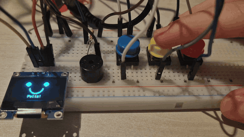
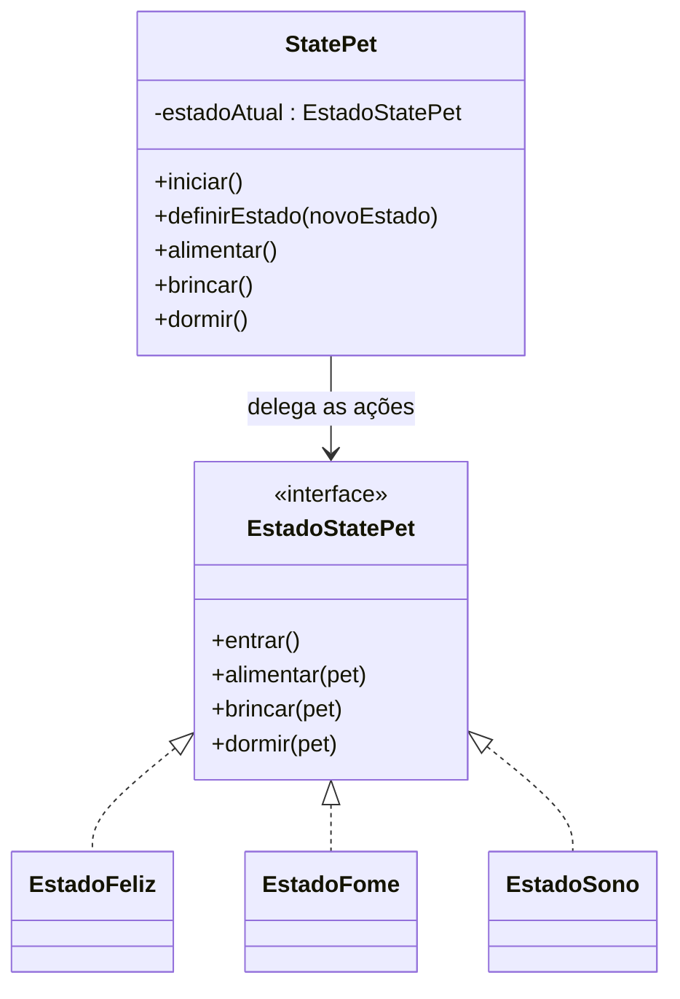
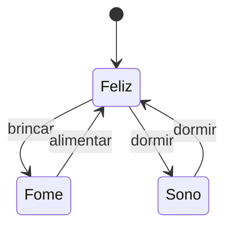
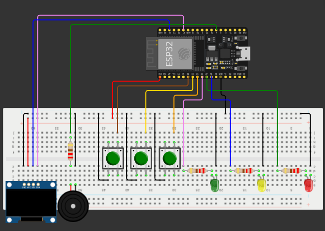
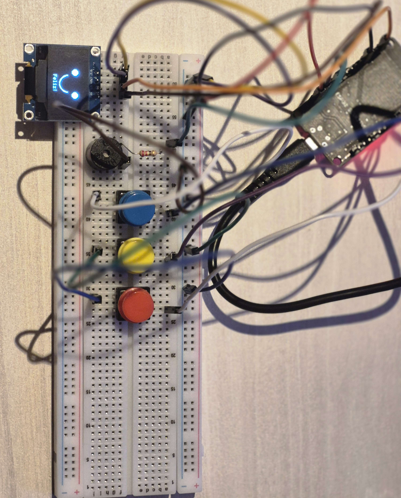

<h1 align="center">StatePet</h1>

<p align="center">
  Mascote virtual (Tamagotchi) feito com <b>ESP32</b> para demonstrar, na prática, o padrão de projeto <b>State</b> (GoF).
</p>

<p align="center">
  <a href="https://wokwi.com/projects/478713551664600065">
    
  </a>
</p>

<p align="center">
  
</p>

## Visão geral

O StatePet é um mascote virtual de bancada. Três botões (brincar, alimentar e dormir) controlam o seu comportamento, e três LEDs, um display OLED e um buzzer indicam o seu estado. O ponto central do projeto é que **a mesma ação produz resultados diferentes conforme o estado em que o mascote se encontra**: brincar deixa o mascote com fome se ele estava feliz, mas apenas o faz chorar se ele já estava com fome.

O projeto foi desenvolvido para a disciplina de Projeto e Arquitetura de Sistemas, como apresentação do padrão State, tendo o [Refactoring Guru](https://refactoring.guru/pt-br/design-patterns/state) como fonte principal.

## O padrão State no código

Em vez de uma classe com uma sequência de condicionais ("se está feliz, faça isto; se está com fome, faça aquilo"), cada estado é uma classe com o seu próprio comportamento, e o mascote apenas delega a ação ao estado em que se encontra.

| Papel no padrão | Classe no código |
| --- | --- |
| Contexto | `StatePet` |
| Interface do estado | `EstadoStatePet` |
| Estados concretos | `EstadoFeliz`, `EstadoFome`, `EstadoSono` |



Cada estado possui ainda o método `entrar()`, executado quando o mascote passa a estar naquele estado. É nele que são definidos o LED aceso, o rosto exibido no display e o padrão sonoro. Dessa forma, a definição do que cada estado mostra fica encapsulada na própria classe do estado, e o contexto não contém nenhuma condicional sobre o estado atual.

## Estados e transições



| Estado atual | Brincar | Alimentar | Dormir |
| --- | --- | --- | --- |
| **Feliz** | Fica com fome | Recusa, não tem fome | Vai dormir |
| **Com fome** | Chora, nada muda | Fica feliz | Recusa, fome demais |
| **Dormindo** | Recusa, está dormindo | Recusa, está dormindo | Acorda feliz |

### Saídas de cada estado

| Estado | LED | Rosto no display | Som |
| --- | --- | --- | --- |
| **Feliz** | Vermelho | Olhos redondos e sorriso | 1 bipe curto |
| **Com fome** | Amarelo | Olhos pequenos, sobrancelhas inclinadas, boca triste e lágrima | 2 bipes curtos |
| **Dormindo** | Verde | Olhos fechados, boca pequena e "Zz" | 1 bipe longo |

Quando um estado recusa uma ação, o display exibe uma mensagem curta por cerca de 1,5 segundo e o buzzer emite um bipe breve.

## Materiais

- 1 placa ESP32 (DOIT ESP32 DEVKIT V1)
- 1 protoboard
- 3 LEDs (vermelho, amarelo e verde)
- 4 resistores de 220 Ω (um para cada LED e um para o buzzer)
- 3 botões (push button)
- 1 display OLED 0,96" 128x64 I2C (controlador SSD1306)
- 1 buzzer ativo
- Jumpers e cabo USB

## Ligações

<p align="center">
  
</p>

| Componente | Função | GPIO |
| --- | --- | --- |
| LED vermelho | Estado feliz | 27 |
| LED amarelo | Estado com fome | 14 |
| LED verde | Estado dormindo | 26 |
| Botão | Brincar | 25 |
| Botão | Alimentar | 33 |
| Botão | Dormir | 32 |
| Buzzer ativo | Sinal sonoro | 4 |
| Display OLED | SDA | 21 |
| Display OLED | SCL | 22 |

Cada LED utiliza um resistor de 220 Ω em série entre o GPIO e o terminal positivo, com o terminal negativo ligado ao GND. Os botões ligam o GPIO ao GND, sem resistor externo, pois o código utiliza `INPUT_PULLUP` (botão pressionado lê `LOW`). O buzzer ativo é ligado ao GPIO 4 por um resistor de 220 Ω, com o outro terminal no GND. O display OLED é alimentado pelo pino 3V3 e responde no endereço I2C `0x3C`. As cores dos componentes podem ser substituídas por outras, desde que os pinos sejam mantidos.

<p align="center">
  
</p>

## Como executar

**Online, sem montar o circuito:** abra o [projeto no Wokwi](https://wokwi.com/projects/478713551664600065), clique no botão de execução e utilize os botões do circuito. O Monitor Serial exibe as mensagens de cada ação.

**Na placa real:**

1. Instale a [Arduino IDE](https://www.arduino.cc/en/software) e o pacote de placas **esp32 by Espressif** pelo Gerenciador de Placas.
2. No Gerenciador de Bibliotecas, instale **Adafruit SSD1306**, aceitando a instalação das dependências (Adafruit GFX Library e Adafruit BusIO).
3. Abra `StatePet/StatePet.ino` (a pasta deve ter o mesmo nome do arquivo).
4. Selecione a placa **DOIT ESP32 DEVKIT V1** e a porta correspondente.
5. Realize o upload. Caso apareça "Connecting...", mantenha o botão BOOT da placa pressionado até o início da gravação.
6. Abra o Monitor Serial em **115200 baud** e utilize os botões.

Caso o display não seja encontrado, o programa informa o problema no Monitor Serial e continua funcionando com LEDs e buzzer.

## Estrutura do repositório

```
StatePet/
├── README.md
├── StatePet/
│   └── StatePet.ino
└── docs/
    ├── demo.gif
    ├── circuito-wokwi.png
    └── foto-montagem.jpg
```

## Referências

- [State — Refactoring Guru](https://refactoring.guru/pt-br/design-patterns/state)
- [Simulador Wokwi](https://wokwi.com)

## Autoria

Desenvolvido por **Letícia Fermanian Gadelha** como trabalho da disciplina de Projeto e Arquitetura de Sistemas.
